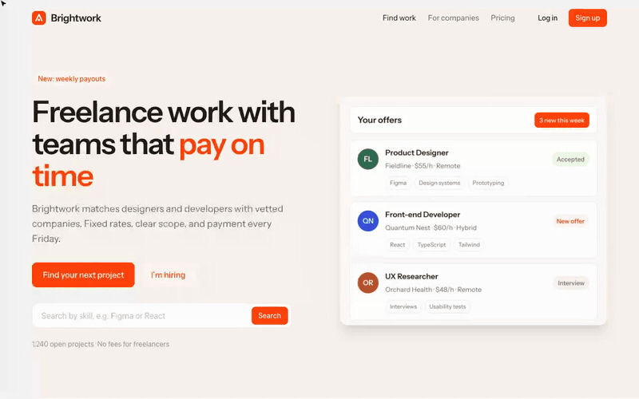
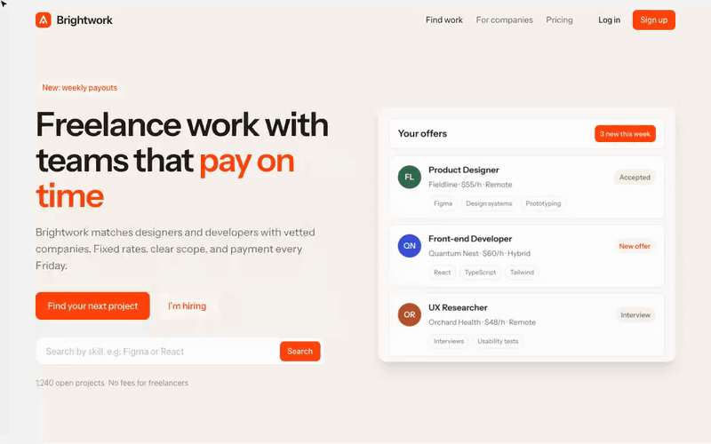
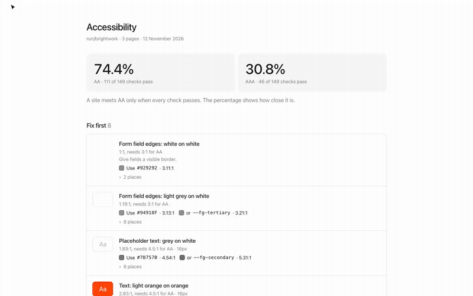
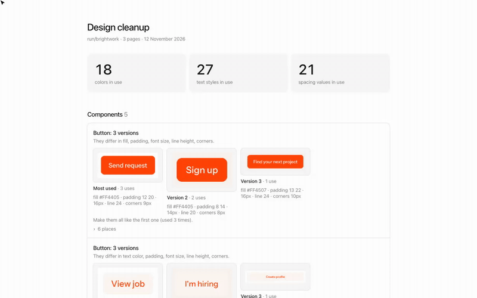
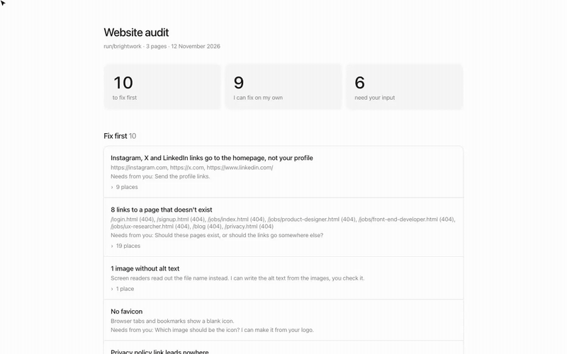

# Design skills for Claude Code

Five [Claude Code](https://claude.com/claude-code) skills for designers who build websites with AI. Two let you change a
page by hand in the browser, three check it before you publish. Claude reads what you did or what the check found,
then edits your code. Your design and copy don't change until you approve.

| Skill | What you get |
|---|---|
| [Tweak mode](tweak-mode/) | A design panel on top of your site. Click anything and tune its font, size, spacing, colors and corners live. |
| [Copy edit mode](copy-edit-mode/) | Click any text on the page and rewrite it in place, plus alt texts, page titles and descriptions. |
| [Accessibility audit](accessibility-audit/) | Color contrast on desktop and phone, in dark mode too if your site follows the system setting. An AA and AAA score, and a color that passes for each issue. |
| [Design cleanup](design-cleanup/) | Buttons, colors, text styles and corners that exist in almost-the-same versions, shown side by side, merged on approval. |
| [Website audit](website-audit/) | Dead links, 404 page, alt text, favicon, legal pages, share images, typos, layouts that break on phones. |

All the screenshots and videos below come from [Brightwork](demo-site/PLANTED.md), a made-up site with problems planted on
purpose. You can run the skills on it too.

## Tweak mode



Say **"turn on tweak mode"**. Claude opens your site with a panel on top. Click an element, change its values, press
Save. Claude writes the changes into your CSS, Tailwind classes or components, in the units your code already uses.
[More](tweak-mode/)

## Copy edit mode



Say **"edit mode"** or **"let me edit the copy"**. Every piece of text on the page becomes editable. Rewrite it where it
sits, so you see how it fits the layout. Alt texts, the page title and the description are in a second tab.
[More](copy-edit-mode/)

## Accessibility audit



Say **"run an accessibility audit"**. It renders your pages in Chrome (up to 20, ask for more) and measures the colors people actually see,
including text on photos and gradients, placeholders, form field edges and icon buttons. You get a report with a
priority and a passing color for each issue, then Claude fixes what you approve.
[More](accessibility-audit/)

## Design cleanup



Say **"clean up the design"**. It finds things like three primary buttons with different padding, cards with 12, 14 and 16px
corners, two greys that look the same, text styles one pixel apart, spacing off the 4px grid, and design tokens that
repeat or go unused. Each set is shown side by side. Claude merges what you approve.
[More](design-cleanup/)

## Website audit



Say **"audit the website"** or **"is my site ready to launch?"**. It checks links, the 404 page, alt text, favicon,
privacy and terms pages, cookie banner, titles, descriptions, share images and typos, and looks at every page at 375,
768, 1024 and 1440px. The report is split into what Claude can fix alone and what needs you.
[More](website-audit/)

## Install

1. Download the zip of a skill from the [latest release](https://github.com/jmackow/skills/releases/latest), or clone this repo.
2. Put the skill's folder in `~/.claude/skills/` (for example `~/.claude/skills/tweak-mode/`). On a Mac: in Finder press
   Cmd+Shift+G, type `~/.claude/skills` and press Enter. If the folder doesn't exist yet, create it in your home
   folder (`.claude` is hidden: Cmd+Shift+. shows it).
3. Start a new Claude Code session (or run `/reload-skills`). Ask for it in your own words, or type `/tweak-mode`.

**You also need:** Python 3 for tweak mode and copy edit mode. Node 20 or newer and Chrome or Edge for the three
audits. The audits install one small package (`playwright-core`) the first time they run. It uses the Chrome you
already have, so nothing big gets downloaded.

**Works with:** plain HTML and CSS, Tailwind, and React, Next.js, Vite and Astro projects (tweak mode also Remix and
SvelteKit). The audits check any site that runs on your computer or a URL. Hosted builders (Webflow, Framer,
WordPress) can be audited, but Claude can't fix them, because there are no files to edit.

## How it stays safe

- The panels run on a small server on your computer (localhost only). Only pages on your computer can save to it.
- In a React, Next.js, Vite or Astro project Claude adds one dev-only line to your layout file to load the panel, and
  removes it when you're done. What you save goes to a JSON file in the project until Claude applies it.
- Claude asks once whether to apply your changes straight away or show them to you first.
- The audits only read your site. Fixes come after you approve them.
- Treat AI fixes like a junior's work: look at the diff before you commit.

## Try it on the demo site

```bash
git clone https://github.com/jmackow/skills
cd skills/demo-site
claude
```

Install the skills first (see [Install](#install)), then ask for any of them. What's planted on the site is listed in [demo-site/PLANTED.md](demo-site/PLANTED.md).

## License

[MIT](LICENSE). Made by [Design Goat](https://designgoat.pl).
