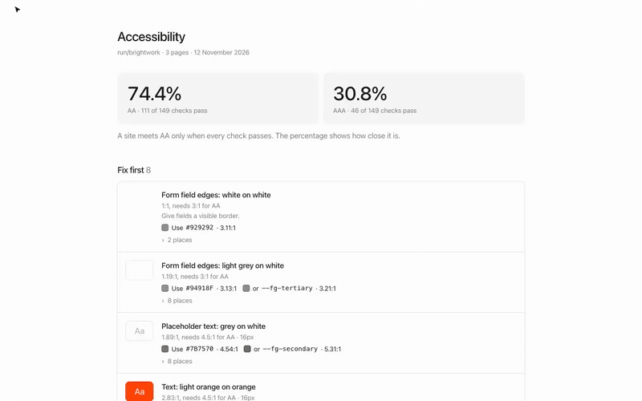
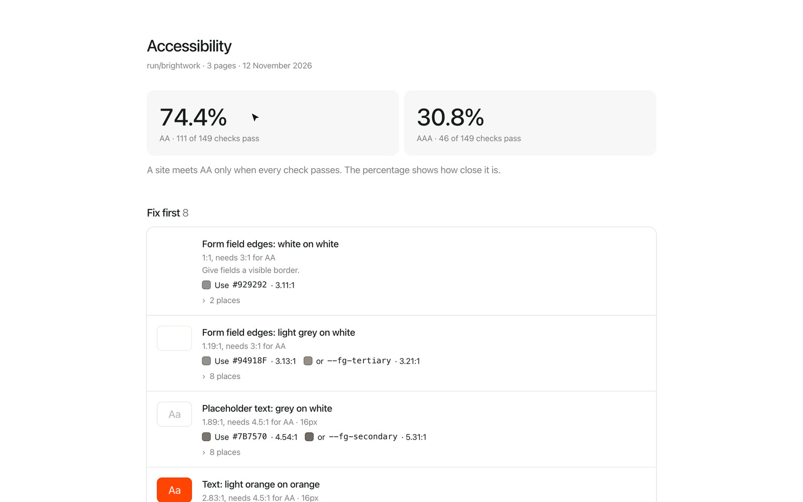
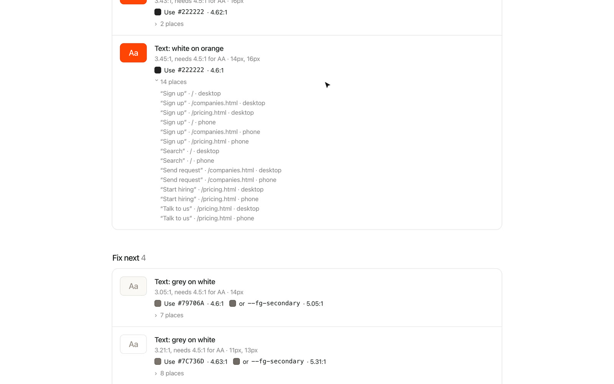
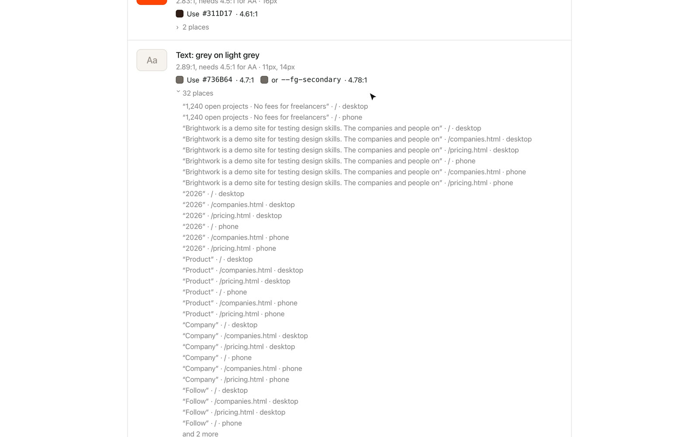

# Accessibility audit

Checks the color contrast of every page against WCAG AA and AAA, the way people see it: text, text on photos and gradients, placeholders, form field edges, icon buttons and links told apart only by color. At desktop and phone width, and in dark mode too if your site follows the system setting (a theme toggle isn't checked yet). Lists very small text too.

[Watch the video (MP4)](../media/accessibility-audit/demo.mp4)

## Install

1. [Download accessibility-audit.zip](https://github.com/jmackow/skills/releases/latest/download/accessibility-audit.zip) and unzip it.
2. Move the `accessibility-audit` folder to `~/.claude/skills/`.
3. Start a new Claude Code session (or run `/reload-skills`).

You also need Node 20 or newer and Chrome or Edge.

## Use

Say "run an accessibility audit", "check the contrast", "does it pass AA?", or type `/accessibility-audit`.

1. Claude runs the check on your local dev server, a folder of HTML files or a URL.
2. You get a report page: an AA and AAA score in %, issues sorted into "fix first", "fix next" and "only fails AAA", each with a color that passes and the places it appears.
3. Claude offers to fix the "fix first" ones with the nearest shade that passes, so the look barely changes. For text on photos it asks how you want it solved.
4. After the fixes it runs the check again.

## On the demo site

**The score and the issues to fix first**

**Each issue with a passing color and every place it appears**

**Light grey text: the token that passes, and all 32 places**

## Good to know

- A site meets a level only when every check passes. The percentage shows how close it is.
- Tap target size is not checked yet.
- Nothing in your files changes until you approve it. Look at the diff before you commit.
