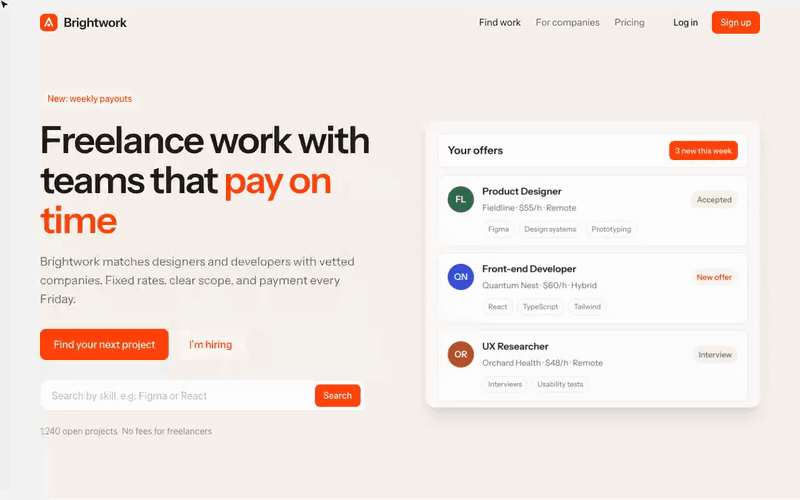
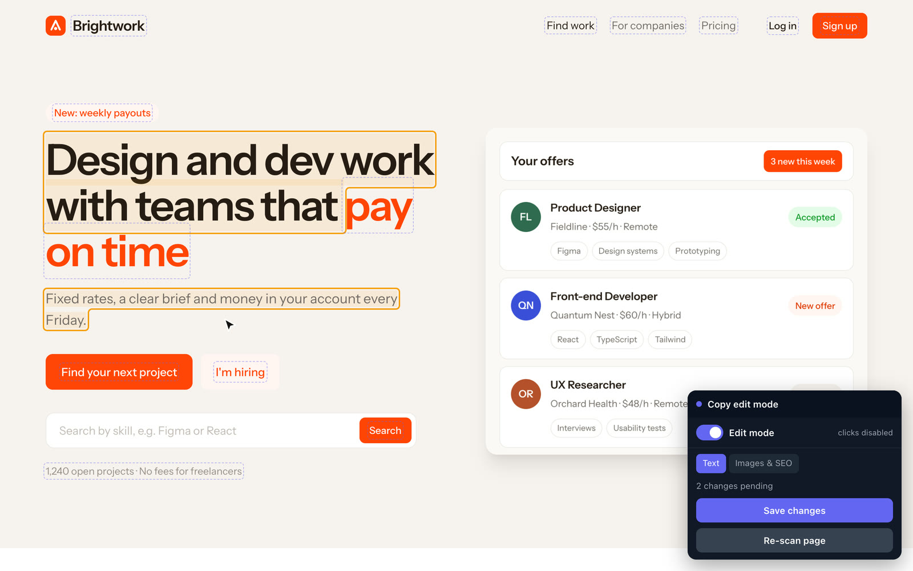
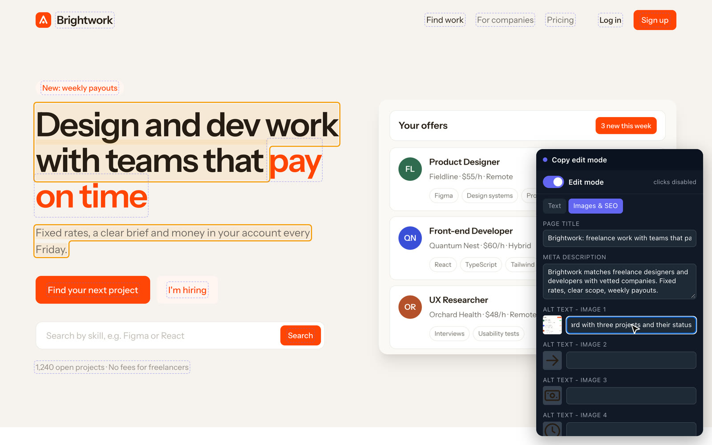
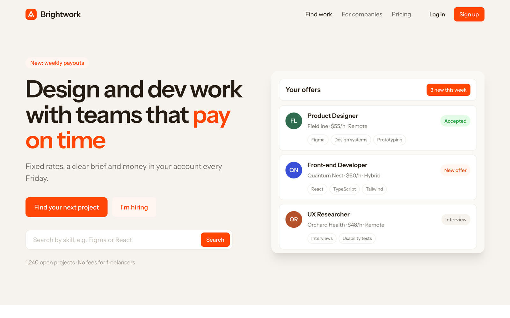

# Copy edit mode

Rewrite the copy on your website where it sits. Every piece of text becomes editable, so you see how a new headline wraps and whether a button label still fits. Alt texts, the page title and the meta description are in a second tab. Claude puts the new text into your files.

[Watch the video (MP4)](../media/copy-edit-mode/demo.mp4)

## Install

1. [Download copy-edit-mode.zip](https://github.com/jmackow/skills/releases/latest/download/copy-edit-mode.zip) and unzip it.
2. Move the `copy-edit-mode` folder to `~/.claude/skills/`.
3. Start a new Claude Code session (or run `/reload-skills`).

You also need Python 3.

## Use

Say "edit mode", "copy pass", "let me edit the text myself", or type `/copy-edit-mode`.

1. Claude serves your site with a small toolbar (for React, Next.js, Vite or Astro it adds one dev-only script tag and removes it at the end).
2. In Edit mode links and buttons do nothing, so a click edits text. Switch to Preview mode (or press Escape) to click through the site.
3. Edited spots turn orange. The "Images & SEO" tab holds alt texts, the page title and the description.
4. Press "Save changes" on each page and tell Claude you are done. It finds each text in your code and replaces it, and lists anything it could not find (text from a CMS or a database).

## On the demo site

**Rewrite the headline and the intro on the page**

**Alt text and page title in the second tab**

**The result in the code after Claude applied it**

## Good to know

- Only text and those attributes change. Tags, classes and structure stay as they are.
- Text inside code blocks, SVGs, text areas and canvases is not editable by design.
- Your design and copy don't change until you approve. The only other edit is a temporary dev-only line in your layout file (app projects), removed at the end. Look at the diff before you commit.
