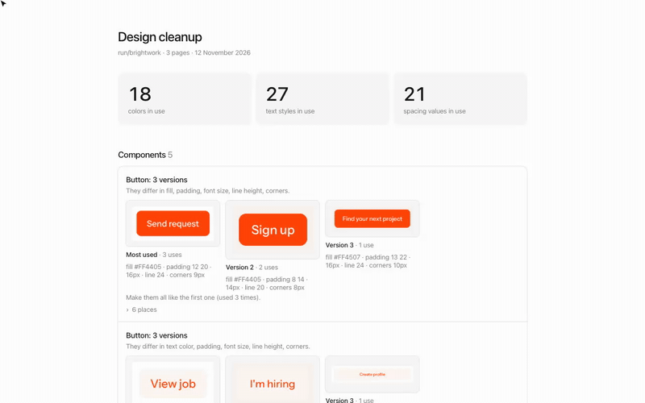
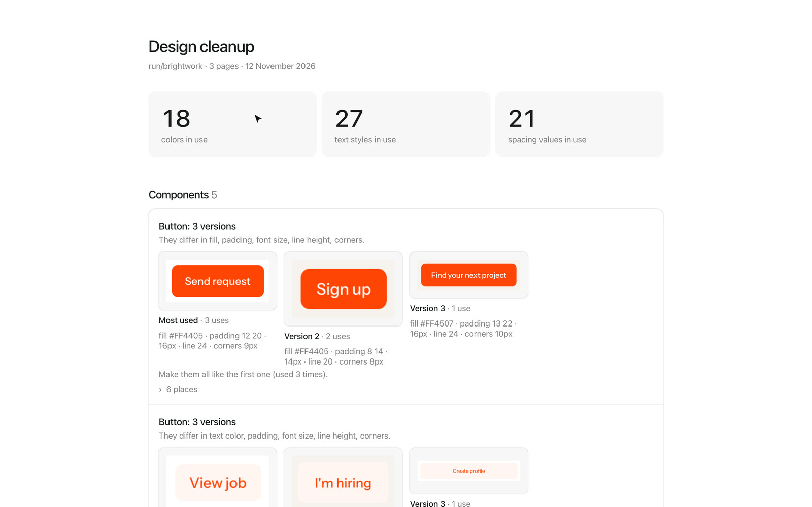
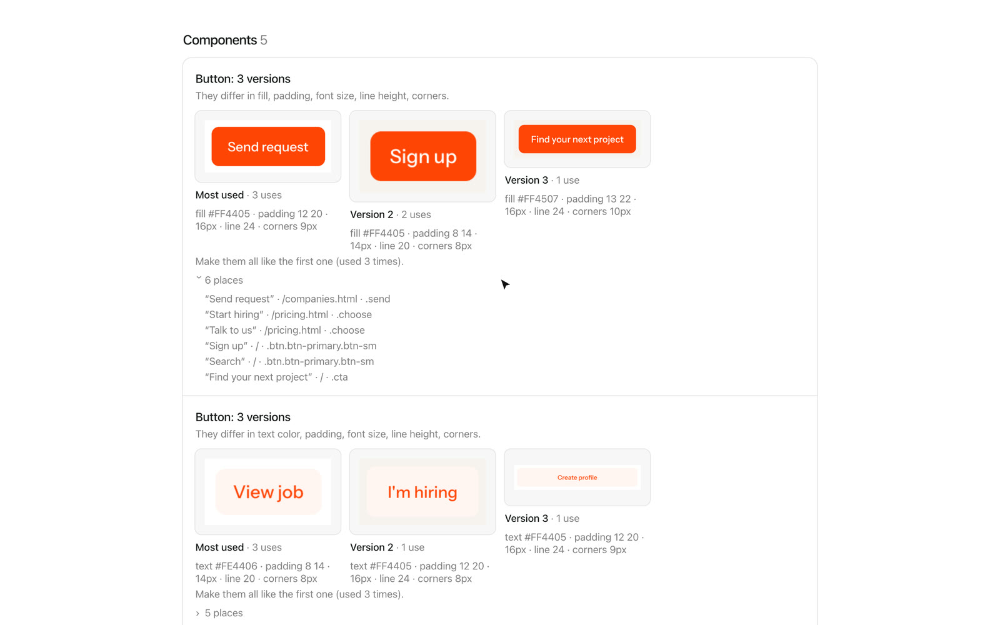
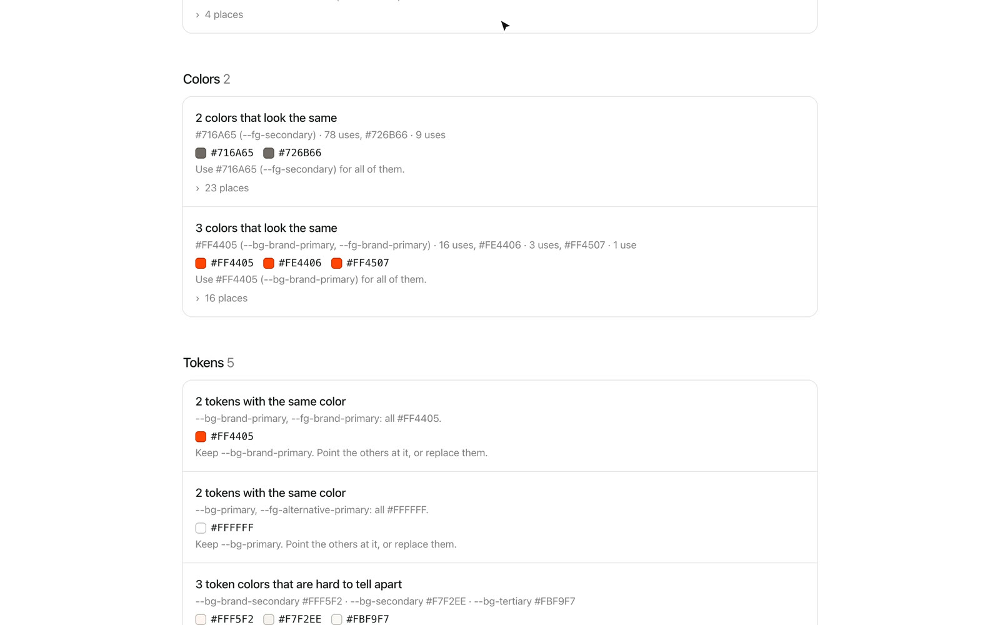

# Design cleanup

Finds what drifted after many rounds of changes: components in slightly different versions (three primary buttons with different padding, cards with 12, 14 and 16px corners), colors that look the same but are not, almost identical text styles, extra fonts, spacing off the 4px grid, and design tokens that repeat, go unused or get typed out by hand.

[Watch the video (MP4)](../media/design-cleanup/demo.mp4)

## Install

1. [Download design-cleanup.zip](https://github.com/jmackow/skills/releases/latest/download/design-cleanup.zip) and unzip it.
2. Move the `design-cleanup` folder to `~/.claude/skills/`.
3. Start a new Claude Code session (or run `/reload-skills`).

You also need Node 20 or newer and Chrome or Edge.

## Use

Say "clean up the design", "check design consistency", "find duplicate styles", or type `/design-cleanup`.

1. Claude renders your pages (up to 20, ask for more) and measures what is actually used.
2. You get a report page that shows each set of versions side by side, with how often each one is used.
3. Claude asks whether some versions are meant to differ (small and large buttons, a hero card) and leaves those alone.
4. It merges the rest into the version you pick (by default the most used one) and swaps typed-out values for your tokens.

## On the demo site

**What is in use: colors, text styles, spacing**

**Buttons in three versions, side by side**

**Colors that look the same, and duplicate tokens**

## Good to know

- Two colors that are each their own token are treated as different on purpose.
- It checks light mode at desktop width.
- Nothing in your files changes until you approve it. Look at the diff before you commit.
