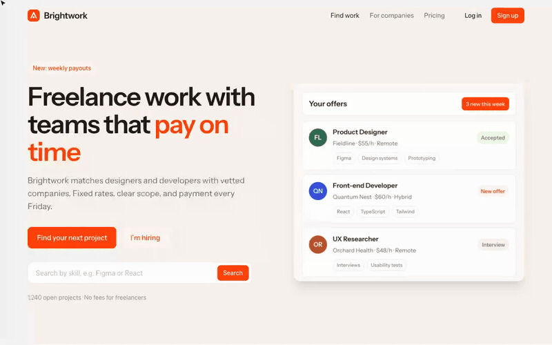
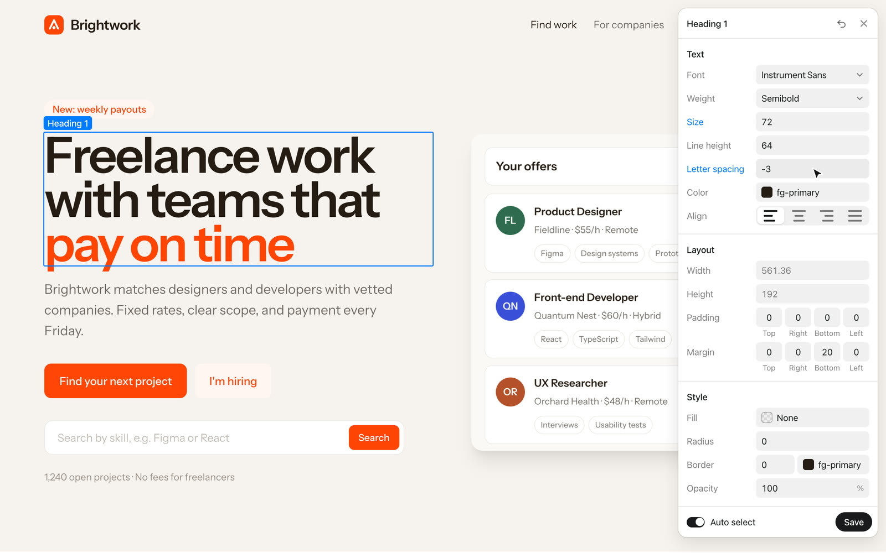
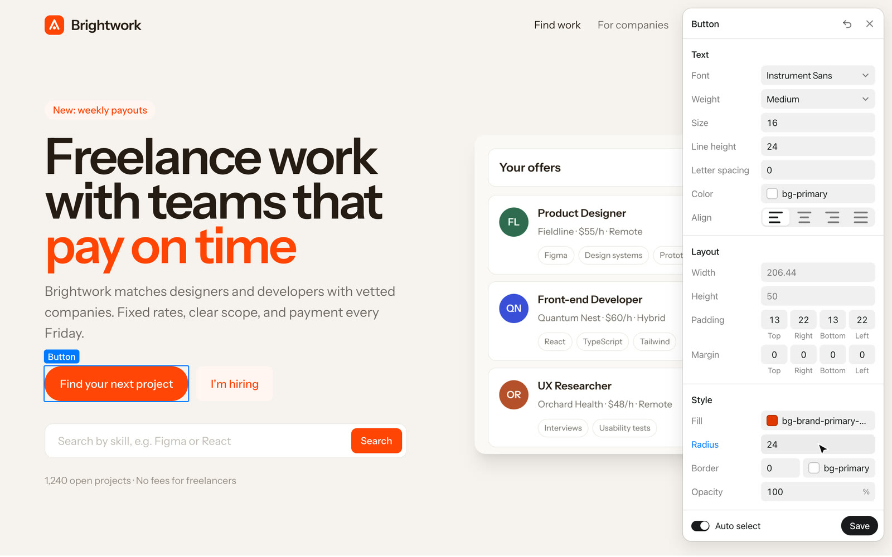
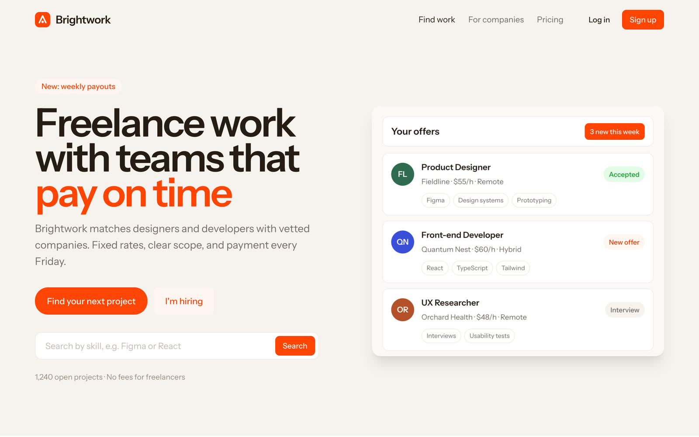

# Tweak mode

A small design panel on top of your real site. Click any element and tune it live: font, weight, size, line height, letter spacing, colors, width, height, padding, margin, gap, corners, border and opacity. Press Save and Claude writes the changes into your CSS, Tailwind classes or components.

[Watch the video (MP4)](../media/tweak-mode/demo.mp4)

## Install

1. [Download tweak-mode.zip](https://github.com/jmackow/skills/releases/latest/download/tweak-mode.zip) and unzip it.
2. Move the `tweak-mode` folder to `~/.claude/skills/`.
3. Start a new Claude Code session (or run `/reload-skills`).

You also need Python 3.

## Use

Say "turn on tweak mode", "design mode", "let me adjust it visually", or type `/tweak-mode`.

1. Claude starts a small local server and opens your site with the panel (for React, Next.js, Vite, Astro, Remix or SvelteKit it adds one dev-only script tag and removes it at the end).
2. Click an element. Auto select picks the outer box first: double-click goes inside, Cmd-click picks the innermost thing.
3. Change values. "All N like it" changes every element with the same class, like a component in Figma. "This one" changes just that element.
4. Press Save and tell Claude you are done. It asks once whether to apply straight away or show you the changes first.

## On the demo site

**Pick the heading, make it bigger and tighter**

**Round the button: every button with that class follows**

**The result in the code after Claude applied it**

## Good to know

- Values are written in the units your code already uses (rem stays rem, a unitless line height stays unitless).
- Hover and focus states are not editable yet.
- Your design and copy don't change until you approve. The only other edit is a temporary dev-only line in your layout file (app projects), removed at the end. Look at the diff before you commit.
