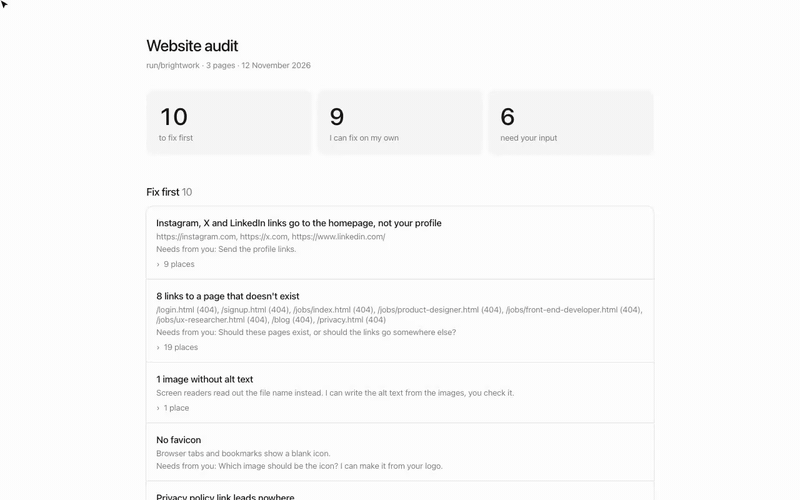
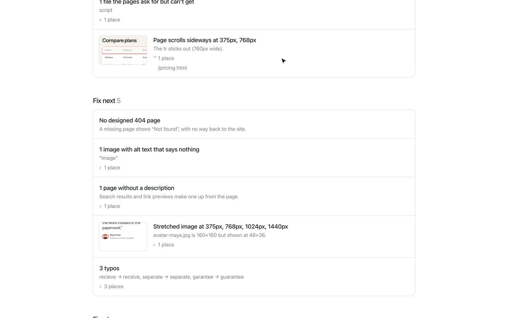
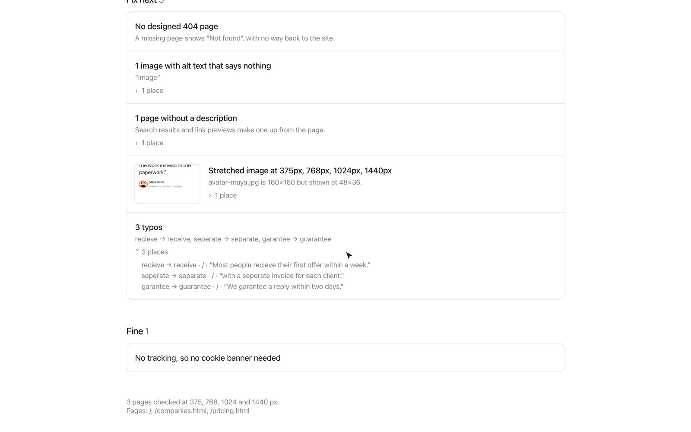

# Website audit

A full check before you publish. Links that go nowhere, to a homepage instead of your profile (instagram.com, x.com) or to missing pages. The 404 page, alt text, favicon, privacy and terms pages, a cookie banner when there is tracking, titles, descriptions, share images and typos. Every page at 375, 768, 1024 and 1440px: sideways scrolling, cut-off text, navigation that disappears, stretched images. Script errors and missing files.

[Watch the video (MP4)](../media/website-audit/demo.mp4)

## Install

1. [Download website-audit.zip](https://github.com/jmackow/skills/releases/latest/download/website-audit.zip) and unzip it.
2. Move the `website-audit` folder to `~/.claude/skills/`.
3. Start a new Claude Code session (or run `/reload-skills`).

You also need Node 20 or newer and Chrome or Edge.

## Use

Say "audit the website", "is my site ready to launch?", "what's broken on my site?", or type `/website-audit`.

1. Claude opens your pages (up to 20, ask for more) at four widths and checks it.
2. It reads the text of each page for typos and adds them to the report.
3. The report splits the issues into "I can fix this" and "I need you" (your Instagram link, which page should exist, the favicon image).
4. Claude fixes its part and asks you about the rest.

## On the demo site

**What to fix first, split into Claude and you**

**Each layout problem with a picture of where it happens**

**Alt text, descriptions, stretched images and typos**

## Good to know

- Point it at your local dev server before launch, or at the live URL after.
- Nothing in your files changes until you approve it. Look at the diff before you commit.
